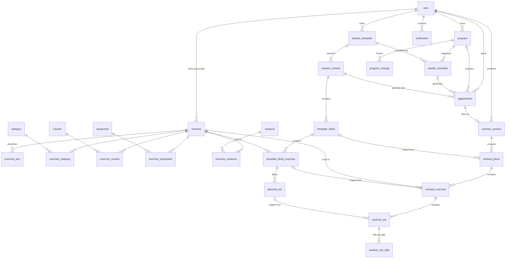

# Modèle de données Fulgora

Le schéma exact (types, clés, index, contraintes) est dans `server/database/schema.sql`. Ce document en donne la lecture : ce que contient chaque table, comment elles sont reliées, et les règles que la base ne peut pas garantir seule.

- MySQL 8.0.16 ou plus, moteur InnoDB, encodage `utf8mb4`.
- 26 tables, noms en anglais, au singulier, en snake_case.
- Identifiants `BIGINT UNSIGNED AUTO_INCREMENT`, dates `DATE`, heures `TIME`, horodatages `DATETIME(3)`.
- Les règles RM-xxx et DT-xx renvoient à `docs/business-rules.md`.

## 1. Vue d'ensemble



## 2. Les tables par domaine

### Compte

| Table  | Contenu                                                                                                                                                                                 | Points clés                                                                                                                                                                       |
| ------ | --------------------------------------------------------------------------------------------------------------------------------------------------------------------------------------- | --------------------------------------------------------------------------------------------------------------------------------------------------------------------------------- |
| `user` | Pseudo, e-mail, hachage du mot de passe, sexe, fuseau horaire, date d'acceptation des conditions, préférences (unités, son, vibration, notifications de minuteur, indicateur d'accueil) | `username` et `email` uniques (RM-001). Unités par défaut : kg et km (DT-11). `terms_accepted_at` obligatoire (RM-001, migration 004), `timezone` par défaut Europe/Paris (D-12). |

### Catalogue

| Table                                                         | Contenu                                                                                                | Points clés                                                                                                                                                      |
| ------------------------------------------------------------- | ------------------------------------------------------------------------------------------------------ | ---------------------------------------------------------------------------------------------------------------------------------------------------------------- |
| `exercise`                                                    | Slug, nom, description, difficulté, illustrations et cartes musculaires homme/femme, archivage         | `owner_user_id` vide = catalogue commun, sinon exercice personnel (RM-007). `source_exercise_id` relie une copie à son original (RM-012, RM-013). `slug` unique. |
| `exercise_text`                                               | Instructions, erreurs à éviter, alternatives, dans l'ordre                                             | Unique sur (`exercise_id`, `type`, `position`).                                                                                                                  |
| `category`, `muscle`, `equipment`                             | Listes de référence (code + nom affiché)                                                               | `code` unique.                                                                                                                                                   |
| `measure`                                                     | Les 8 mesures : `reps`, `weight`, `duration`, `distance`, `speed`, `resistance`, `incline`, `calories` | `code` unique.                                                                                                                                                   |
| `exercise_category`, `exercise_equipment`, `exercise_measure` | Tables de liaison                                                                                      | Clé primaire sur le couple.                                                                                                                                      |
| `exercise_muscle`                                             | Liaison avec le rôle `primary` ou `secondary`                                                          | Au moins un `primary` par exercice (RM-009), contrôlé par le serveur.                                                                                            |

### Séances préparées (le prévu)

| Table                     | Contenu                                                                                       | Points clés                                                                                                                                                 |
| ------------------------- | --------------------------------------------------------------------------------------------- | ----------------------------------------------------------------------------------------------------------------------------------------------------------- |
| `session_template`        | La séance préparée (nom, propriétaire)                                                        |                                                                                                                                                             |
| `session_version`         | Une version figée de son contenu                                                              | Unique sur (`session_template_id`, `version_number`). Jamais modifiée une fois utilisée (RM-017).                                                           |
| `template_block`          | Un bloc : type, nom, position, tours prévus, temps limite, consigne                           | Position unique dans la version (RM-024).                                                                                                                   |
| `template_block_exercise` | Un exercice dans un bloc, son repos par défaut, et s'il se fait côté par côté (`is_per_side`) | Position unique dans le bloc. `is_per_side` depuis la migration 005 (US-51, D-02).                                                                          |
| `planned_set`             | Une série prévue et ses objectifs (une colonne par mesure), charge gauche et droite comprises | Position unique dans l'exercice. `rest_after_seconds` remplace le repos par défaut (RM-023). `weight_left_kg` et `weight_right_kg` depuis la migration 005. |

### Programmes

| Table             | Contenu                                                 | Points clés                                                                                                                                                             |
| ----------------- | ------------------------------------------------------- | ----------------------------------------------------------------------------------------------------------------------------------------------------------------------- |
| `program`         | Nom, période, statut                                    | Fin ≥ début. Statuts : `draft`, `programmed`, `in_progress`, `finished`, `abandoned` (migration 003, RM-071). `source_program_id` pour un programme réutilisé (RM-036). |
| `weekly_schedule` | « Telle séance, tel jour de la semaine, à telle heure » | Jour ISO 1 (lundi) à 7. `deactivated_at` quand la règle change (RM-031).                                                                                                |
| `program_change`  | Historique des changements                              | Ancienne et nouvelle valeur en JSON (RM-037).                                                                                                                           |

### Agenda et réalisation (le réalisé)

| Table              | Contenu                                                                     | Points clés                                                                                                                                                                                                                                 |
| ------------------ | --------------------------------------------------------------------------- | ------------------------------------------------------------------------------------------------------------------------------------------------------------------------------------------------------------------------------------------- |
| `appointment`      | Une séance planifiée à une date                                             | Pointe vers une **version** de séance. `initial_date` et `moved_manually` pour les déplacements (RM-032). Sans programme = séance libre (RM-015). `cancelled_at` rempli exactement quand le statut est `cancelled` (migration 002, RM-035). |
| `workout_session`  | La séance réellement faite                                                  | Un seul par rendez-vous (RM-038). `last_activity_at` pour la clôture à 4 h (RM-065). Une seule `in_progress` par utilisateur (DT-15). `auto_closed` et `declared_afterwards` depuis la migration 004 (US-33, US-38).                        |
| `workout_block`    | Copie du bloc prévu, plus les résultats (tours, durée réelle)               | `source_template_block_id` vide = bloc ajouté pendant la séance (RM-043).                                                                                                                                                                   |
| `workout_exercise` | Copie de l'exercice prévu, plus un commentaire et `is_per_side`             | Même logique d'origine. `is_per_side` copié du prévu (migration 005).                                                                                                                                                                       |
| `workout_set`      | Chaque mesure en double : `_planned` (copié, figé) et `_actual` (saisi)     | `validated_at` = première validation, `updated_at` vide jusqu'à une correction (RM-049, DT-14). Charges gauche et droite prévues depuis la migration 005.                                                                                   |
| `workout_set_side` | Ce qui a été fait de chaque côté d'une série côté par côté (gauche, droite) | Clé primaire (`workout_set_id`, `side`). La série n'est validée qu'une fois les deux côtés saisis (migration 005, RM-044).                                                                                                                  |

### Alertes

| Table          | Contenu                                                                                      | Points clés                                                                                       |
| -------------- | -------------------------------------------------------------------------------------------- | ------------------------------------------------------------------------------------------------- |
| `notification` | Type, titre, message, lien vers un rendez-vous, un programme ou un exercice, date de lecture | Une seule « séance à confirmer » et une seule « séance manquée » par rendez-vous (RM-056, DT-16). |

## 3. Le principe du prévu et du réalisé

Au démarrage d'une séance (RM-041), le serveur **copie** la version prévue dans les tables `workout_*` :

```
session_version ──copie──► workout_session
  template_block ──copie──► workout_block            (source_template_block_id)
    template_block_exercise ──copie──► workout_exercise   (source_template_block_exercise_id)
      planned_set ──copie──► workout_set              (source_planned_set_id, colonnes _planned)
```

Le prévu copié ne change plus jamais. L'utilisateur ne remplit que les colonnes `_actual`. Un élément ajouté pendant la séance a une origine vide : c'est ce qui permet de savoir qu'il peut être supprimé (RM-048).

## 4. Ce que la base ne garantit pas seule

Ces règles sont vérifiées par le serveur, dans les actions, avec des tests :

1. **Cohérence des propriétaires** : le rendez-vous, la séance réalisée, la séance préparée et le programme appartiennent au même utilisateur.
2. **Versions immuables** : une version utilisée et tout son contenu ne sont jamais modifiés ; toute modification crée une nouvelle version.
3. **Origines cohérentes** : une série réalisée ne peut venir que d'une série prévue de la même chaîne.
4. **Au moins un muscle principal** par exercice.
5. **Démarrage d'une séance** : verrouillage, vérification du rendez-vous, copie et changement de statut dans une seule transaction.
6. **Suppression d'un compte** : suppression des données dans l'ordre inverse des dépendances, dans une seule transaction (les clés en `RESTRICT` empêchent toute suppression accidentelle, DT-17).

## 5. Le catalogue initial

Chargé par `npm run db:seed` depuis `server/database/seed/catalog.json` :

| Table           | Lignes |
| --------------- | ------ |
| `exercise`      | 151    |
| `exercise_text` | 1 485  |
| `category`      | 8      |
| `muscle`        | 15     |
| `equipment`     | 6      |
| `measure`       | 8      |

Illustrations et données : Marc Mayol (crédit obligatoire dans « À propos »). Cartes musculaires dérivées de react-native-body-highlighter (licence MIT).

## 6. Limites connues

- Les résultats tour par tour d'un circuit ou d'un AMRAP ne sont pas détaillés : seuls les totaux sont dans `workout_block` (question O-02).
- `exercise_text` n'a pas de colonne de langue : le contenu est en français. Une version multilingue demanderait une évolution du schéma.
